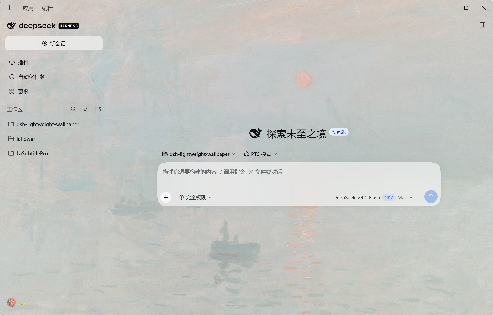
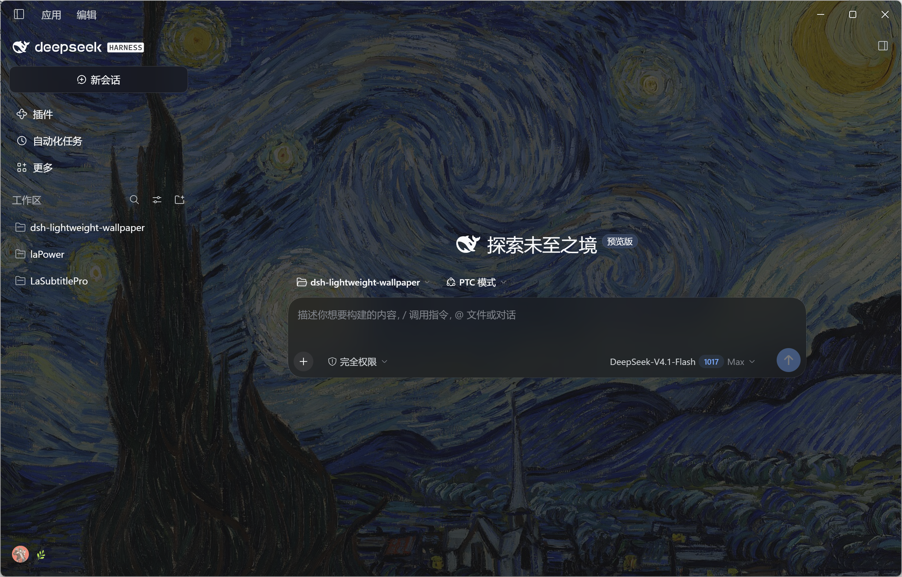

[简体中文](README.md) | English

<div align="center">


# dsh-lightweight-wallpaper

**A lightweight wallpaper plugin for DeepSeek Harness: four sources, full-window coverage, cards and dialogs stay solid, and glass only on two surfaces. Zero runtime dependencies, no build step, no bundled images.**

[](https://github.com/KHWLGH/dsh-lightweight-wallpaper/blob/main/package.json)
[](LICENSE)
[](https://github.com/KHWLGH/dsh-lightweight-wallpaper/stargazers)
[](https://github.com/KHWLGH/dsh-lightweight-wallpaper/commits/main)
[](https://github.com/KHWLGH/dsh-lightweight-wallpaper/issues)


[](https://github.com/deepseek-ai/deepseek-harness)

</div>

## Preview

| Light theme | Dark theme |
| :---: | :---: |
|  |  |
| Claude Monet, *Impression, Sunrise*, 1872 | Vincent van Gogh, *The Starry Night*, 1889 |

## About

The plugin paints a wallpaper on the bottom layer of the Harness window: the canvas and sidebar let it show through, while cards, dialogs and code blocks stay solid so text remains readable. Only the composer card and the sidebar New session button get an extra glass layer.

Four sources feed the wallpaper: Bing daily, public-domain paintings from Wikimedia Commons, CC0 works from the Cleveland Museum of Art, and local uploads. Every upstream request is made by the host on the plugin's behalf and cached locally — the browser never talks to third-party APIs directly, and the last successful result is replayed when the network or the upstream fails.

Settings, images and caches all live under `$DSH_HOME/lightweight-wallpaper/`, so they survive port changes and browser switches.

## Features

### Wallpaper sources

- **Bing daily**: the last 16 days, with `zh-CN` / `en-US` / `ja-JP` / `en-GB` regions; 8 images per page, 2 pages.
- **Wikimedia Commons**: public-domain and freely licensed paintings; search for an artist, work or movement, or use one of the 8 presets.
- **Cleveland Museum of Art**: only items whose `share_license_status` is `CC0`; the pager shows the total count.
- **Upload**: JPEG / PNG / WebP; files over 6MB are downscaled to a 2560px longest edge in the browser before upload.

### Display and readability

- **Full-window wallpaper + four global controls**: the wallpaper covers the bottom layer; fill mode (cover / contain), window scrim, dim and wallpaper blur are all adjustable, and the sliders preview live.
- **Glass on two surfaces only**: the composer card and the sidebar New session button share one opacity and one blur; turning the master switch off makes them solid again.
- **Readable popovers**: while a wallpaper is active, the composer "+" menu, the model picker and other popovers turn near-solid with a background blur, so small text no longer drowns in the artwork.
- **Light-mode contrast boost**: secondary greys outside the glass step darker (`label-secondary` 700→800, `label-tertiary` 600→750, `label-caption` 400→700); the dark theme and the wallpaper-off state are untouched.
- **Theme sync**: the scrim colour follows the system light/dark theme (including "follow system") and never stays on the previous palette after a switch.

### Browsing and local wallpapers

- **Paged browsing**: 24 images per art page; Wikimedia Commons pages continuously, Cleveland shows the total count, and Bing daily has 2 pages. Changing the source, the preset or the query returns to page 1.
- **8 art presets**: Van Gogh, Monet, Impressionism, Chinese landscape, Ukiyo-e, Renaissance, Vermeer and Klimt on a single row; any artist, work or movement can also be typed in directly.
- **Local wallpapers** (the default tab): the list is the on-disk library — downloads and uploads alike — capped at 20 entries, ordered by recent use, and a click switches straight back. Rows whose file is gone (deleted by hand, pushed out or cache-cleared) are dropped on the next read, and images already on disk without a row are added back automatically.

### Cache and persistence

- **Local cache**: applied images are stored under `assets/` and still display offline; when the upstream fails, the last successful list is replayed and *The Starry Night* remains as the built-in fallback row.
- **Thumbnail cache**: list thumbnails land in `thumbs/`, so the second visit and every restart paint instantly; grid tiles ask for 500px and fall back to the original list URL when that width is refused.
- **Cache management**: shows entry counts and disk usage for local wallpapers, thumbnails and list snapshots, clears them separately, or clears everything (the button becomes "Confirm clear" once, executes on the second click, and cancels when you click elsewhere). Clearing always keeps the current wallpaper and every setting.
- **Rotate daily**: when on, each Harness launch pins that day's Bing image and caches it locally.
- **Settings persist in the host**: port changes and browser switches lose nothing.

## Installation

Pick one of three routes. The first install or enable needs one full Harness restart; after that, code changes reload without a restart — see Development.

### From GitHub

```bash
dsh plugin --profile desktop add github:KHWLGH/dsh-lightweight-wallpaper
```

To pin a version, append the commit:

```bash
dsh plugin --profile desktop add github:KHWLGH/dsh-lightweight-wallpaper#<commit>
```

The plugin has no build step and no install-time scripts, so a Git install needs no `allowBuilds` approval.

### From the Plugin Manager

**Plugins** → **Add plugin**, paste `https://github.com/KHWLGH/dsh-lightweight-wallpaper` (a package name or a local directory path works too) and press Install.

### From a local directory

```bash
dsh plugin --profile desktop add "<absolute path to this directory>"
```

Remove with `dsh plugin --profile desktop remove dsh-lightweight-wallpaper`; to update, remove and add again (a Git install resolves the latest commit on the default branch). These commands are equivalent to the Plugin Manager actions.

## Usage

Settings → **Wallpaper**. The page has three groups:

- **Wallpaper**: master switch, current wallpaper, choose a wallpaper (local / Bing daily / museum art / upload).
- **Display**: display controls (with Self-check and Reset to recommended at the bottom), glass, rotate daily.
- **Data**: cache usage and clearing.

Every control saves automatically; clicking any thumbnail applies it.

## Defaults

| Setting | Default | Notes |
|---|---|---|
| Fill mode | Cover | Contain is also available |
| Window scrim | 62% | Base scrim over the whole window; lower values reveal more wallpaper (30–100%) |
| Dim | 18% | A dark layer over the wallpaper that protects body-text contrast |
| Wallpaper blur | 0 | 0–24px |
| Glass | On | Composer card + New session button |
| Glass opacity | 55% | 0–100%, shared by both surfaces; 0% is fully transparent |
| Glass blur | 24px | 0–40px, shared by both surfaces |
| Light-mode contrast boost | On | Secondary greys step to the 800 / 750 / 700 scale |

## Data and cache

Everything lives under `$DSH_HOME/lightweight-wallpaper/`:

```text
├── state.json            current wallpaper and settings
├── history.json          local wallpaper list (up to 20, downloads and uploads)
├── assets/<sha1>.<ext>   applied images (up to 20, deduplicated by content hash)
├── thumbs/<sha1>.img     list thumbnails (7-day TTL, at most 240 files / 48MB)
├── art-cache.json        last successful art lists (by source, query and page, up to 16 entries)
├── bing-<mkt>-<idx>.json last successful Bing list (fallback when the API fails)
└── selfcheck.json        the latest self-check report (from Self-check, or written on boot)
```

The browser `localStorage` only keeps a first-paint snapshot; it is never the source of truth. List caches are served directly for 30 minutes; after that the host asks the upstream again, and replays the previous successful result (flagged as stale) when that request fails.

## Sources and licenses

| Source | Endpoint | License | Notes |
|---|---|---|---|
| Bing daily | `HPImageArchive.aspx` | Microsoft limits it to wallpaper use | No download or export button |
| Wikimedia Commons | `commons.wikimedia.org/w/api.php` | Public domain / CC, per item | JPEG / PNG only, at least 1200 × 800; uses the 500 / 960 / 1280 / 1920 thumbnails, never the original |
| Cleveland | `openaccess-api.clevelandart.org` | **CC0** | Only items with `share_license_status = CC0` |

Thumbnails show the author and the license; after applying, the source and copyright stay at the top of the settings page.

## Self-check and troubleshooting

Settings → Wallpaper → **Self-check** at the bottom of Display writes the computed styles of the wallpaper layer, the scrim layer and the official containers (frame, sidebar, content column, input area, New session button), the glass and contrast state, theme consistency, the list of opaque surfaces and the element stacks under the mouse into `selfcheck.json`; the page also writes one automatically on every boot. When the wallpaper is invisible, a white edge appears or the glass does nothing, check these first:

- `--dsw-alias-bg-base` and `--dsw-specific-sidebar-fill` should be `rgba(0,0,0,0)`; `html::after` is the only base scrim and `html::before` points its `background-image` at the local asset.
- `scheme.paint`, `scheme.service` and `scheme.colorScheme` should match `scheme.bodyDark`; with a wallpaper active, `scrim.matches` and `glassTint.matches` should be `true`.
- In the light theme with the contrast switch on, `glassVariables` should report `#353638` / `#43454a` / `#61666b` for `labelSecondary` / `labelTertiary` / `labelCaption`, and `menuSurfaceFill` should be `#f8f9faf0` (light) or `#33343af0` (dark).
- `navIcon.matched` and `navIcon.decorated` being `true` means the navigation icon decoration applied; any unexpected entry in `opaqueSurfaces` is where a white block comes from.

## Known limitations

### Window and shell

- The native Windows title bar (about 40px) is drawn by the Electron shell; page CSS cannot cover it, so it stays solid.
- The settings panel is fixed at 800px wide (a ~564px content column), so the plugin page uses a single-column layout.
- A few official controls with hard-coded colours do not let the wallpaper through; the settings dialog itself stays solid (on purpose).

### Style dependencies and readability trade-offs

- The glass depends on the official CSS-module class suffixes (`_composerSeat`, `_newSession`, and so on); after a major DSH version changes them, update the selectors using the self-check report.
- When `backdrop-filter` is disabled, the glass keeps its tint but loses the background blur; readability is unaffected.
- The light-mode contrast boost also darkens secondary greys inside popovers and cards, because the official tokens are global; turn the switch off if that is not what you want.

### Upstream APIs and upload formats

- Uploads accept JPEG / PNG / WebP only; files over 6MB are downscaled to a 2560px longest edge in the browser first.
- Wikimedia Commons occasionally answers 429 or times out; the list then shows the last successful result, and very deep pages drift slightly with the upstream index.
- Wikimedia Commons only accepts its standard thumbnail widths (20 / 40 / 60 / 120 / 250 / 330 / 500 / 960 / 1280 / 1920 / 3840) and answers `400` for anything else; the plugin snaps grid tiles to the nearest step (480 → 500px) and falls back to the original URL if that still fails.

## Development (no restart)

Code changes do not need a Harness restart:

| Change | How it applies |
| --- | --- |
| `src/client.js` | Official Client HMR: about a second after saving, the bundle reloads inside the page (`/plugins/events` SSE compares file mtime and size every 500ms), with the settings page left open |
| `src/impl.js`, `src/sources.js` | The host entry `src/index.js` is a stable shim: it compares these two files every 800ms and, when they change, `import('./impl.js?rev=…')` starts a new generation and disposes the old one — the new code takes over in about a second |
| `src/index.js` (the shim itself), `package.json`, the meta in `locale/*.json`, `cordis.patch.yml` | Registration layer — still needs one restart |

```bash
npm run dev     # = node tools/dev.mjs: node --check plus the matching test on save; fix red first
npm run check   # run host-smoke + client-contract by hand
```

`src/impl.js` imports `sources.js` with the same `?rev=`, so editing `sources.js` hot-reloads too; when a host reload fails, the previous generation keeps serving and only a warning is logged.

## Verification

```bash
node --check src/index.js && node --check src/impl.js && node --check src/client.js
node tools/host-smoke.mjs        # 37 checks: host routes / cache / history (20 + backfill) / thumbnails / entry shim and reload lifecycle
node tools/client-contract.mjs   # 13 checks: module envelope, registration contract, presets and pager, cards and layout, local list
node tools/probe-sources.mjs     # upstream connectivity probe (network required)
node tools/dev.mjs               # dev loop: syntax gate on save plus the matching test
```

## Implementation

- **A single base scrim**: every official container token (`--dsw-alias-bg-base`, `--dsw-specific-sidebar-fill`) is set transparent, and the plugin paints both the wallpaper and the scrim itself.
- **Glass on exactly two selectors**: `[class*="_composerSeat"] [class*="_card"]` and `[class*="_newSession"]`; global tokens such as `--dsw-specific-input-major` are left alone.
- **Theme colours come from the service snapshot**: the scrim colour `--lww-floor` comes from the `theme/change` payload (falling back to `ctx.theme.getTheme()`); the glass tint `--lww-scrim-rgb` is decided by CSS from `body[data-ds-dark-theme]`, with a `MutationObserver` as a safety net.
- **Contrast uses the official scale variables**: in the light theme `label-secondary` 700 → 800, `label-tertiary` 600 → 750 and `label-caption` 400 → 700, and the switch can turn it all off.

The host and the browser talk over a same-origin API under `/api/lightweight-wallpaper`:

| Method | Path | Purpose |
|---|---|---|
| GET / POST | `/state` | Read or write the current wallpaper and settings |
| GET | `/bing?mkt&n&page` | Bing daily list (paged by region) |
| GET | `/art?source&q&limit&page` | Paged Wikimedia or Cleveland search |
| POST | `/pin` | Download and cache one image |
| POST | `/upload` | Upload raw image bytes |
| GET | `/asset/<sha1>.<ext>` | Serve a cached local image |
| GET | `/proxy?u&w` | Same-origin image proxy that snaps thumbnail widths to the official steps |
| GET | `/history` | Local wallpaper list |
| GET | `/cache` and POST `/cache/clear` | Cache statistics and clearing |
| GET | `/health` | Cache health check |

Non-GET requests must carry an `x-dsh-plugin: lightweight-wallpaper` header: a cross-site form cannot set it, and the server answers no CORS preflight.

## Project layout

```text
src/index.js     host entry shim: keeps the registration layer stable, watches the two files below and hot-reloads the host half
src/impl.js      host: same-origin routes, paging parameters, history, cache stats and clearing, upstream / list / thumbnail caches, image proxy, state persistence
src/sources.js   pure functions: URL builders for the three sources (with paging), paging metadata, thumbnail widths, response normalization
src/client.js    client: wallpaper layer + window scrim + glass, the settings page (local wallpapers / cache manager) and the self-check
tools/           smoke tests, contract checks, a connectivity probe and the dev loop (development only, not part of the running plugin)
```

## License

MIT. Wallpapers remain the property of their sources; this plugin only displays and caches them locally.
