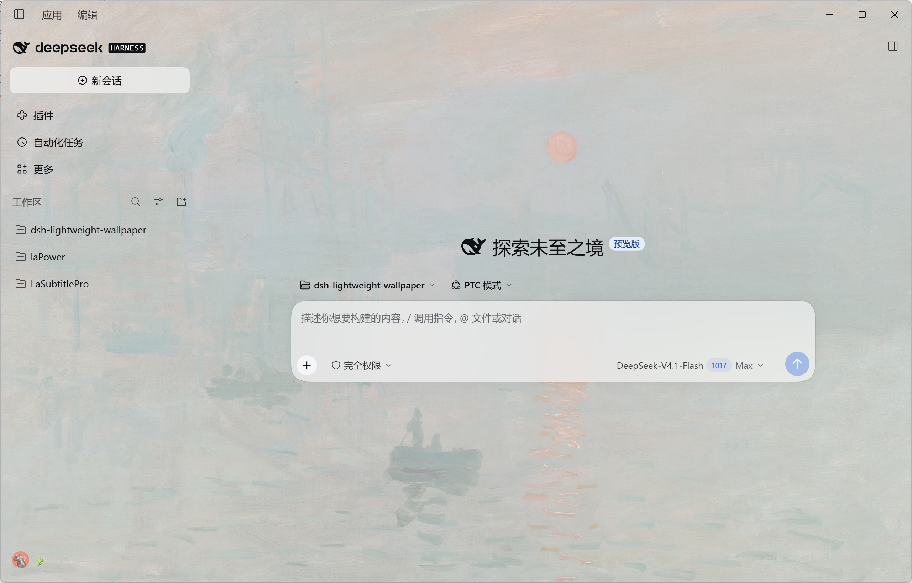
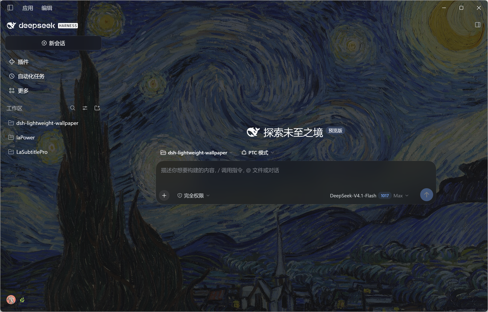

简体中文 | [English](https://github.com/KHWLGH/dsh-lightweight-wallpaper/blob/main/README.en.md) | [更新日志](https://github.com/KHWLGH/dsh-lightweight-wallpaper/blob/main/CHANGELOG.md)

<div align="center">


# dsh-lightweight-wallpaper

**给 DeepSeek Harness 的轻量壁纸与字体插件：五种壁纸来源、整窗铺满，卡片与弹窗保持实心，毛玻璃只上两处；界面、代码与终端字体可从系统字体中选择。零运行时依赖、零构建步骤、不打包任何图片或字体。**

[](https://www.npmjs.com/package/dsh-lightweight-wallpaper)
[](https://www.npmjs.com/package/dsh-lightweight-wallpaper)
[](https://github.com/KHWLGH/dsh-lightweight-wallpaper/blob/main/LICENSE)
[](https://github.com/KHWLGH/dsh-lightweight-wallpaper/stargazers)
[](https://github.com/KHWLGH/dsh-lightweight-wallpaper/commits/main)
[](https://github.com/KHWLGH/dsh-lightweight-wallpaper/issues)


[](https://github.com/deepseek-ai/deepseek-harness)

</div>

## 界面预览

| 浅色主题 | 深色主题 |
| :---: | :---: |
|  |  |
| 克劳德·莫奈《印象·日出》，1872 | 文森特·梵高《星空》，1889 |

## 简介

插件把壁纸铺在 Harness 窗口的最底层：画布与侧栏透出壁纸，卡片、弹窗与代码块保持实心可读；只有输入框卡片和侧栏「新会话」按钮额外加一层毛玻璃。设置页的「字体」组还能从系统字体中选择界面字体、代码字体和终端字体；代码字体同时作用于代码块与侧栏文件预览/编辑器，终端字体作用于侧栏终端。

壁纸来源有五种：必应每日、维基共享的公共领域名画、克利夫兰艺术博物馆的 CC0 馆藏、10wallpaper，以及本地上传的图片。所有上游请求都由宿主代发并在本地缓存，浏览器不直连第三方接口；断网或上游失败时，回放上一次成功的结果。

壁纸设置、图片与缓存全部落在 `$DSH_HOME/lightweight-wallpaper/`，换端口、换浏览器都不会丢；字体选择则写入 DSH 的 `ui-theme` 设置，由官方设置 API 持久化。

## 功能特性

### 壁纸来源

- **必应每日**：最近 16 天，可选 `zh-CN` / `en-US` / `ja-JP` / `en-GB` 四个地区；每页 8 张，共 2 页。
- **维基共享**：公共领域与自由许可的名画，可搜索画家、作品或流派，也可直接选用 8 个预设。
- **克利夫兰艺术博物馆**：只收录 `share_license_status = CC0` 的条目，翻页时显示「共 N 张」。
- **10wallpaper**（「壁纸站」标签）：列表/搜索 12 张/页、分类 20 张/页；风景 / 游戏 / 城市 / 太空 / 动物 / 设计分类，可关键词搜索；默认取 3840×2160，失败时回退 2560/1920/1366。
- **本地上传**：支持 JPEG / PNG / WebP；超过 6MB 会先在浏览器压到最长边 2560 再上传。

### 显示与可读性

- **整窗壁纸 + 四个全局参数**：壁纸铺满最底层；填充方式（铺满 / 适应）、整窗遮罩、压暗、壁纸模糊都可调，滑杆所见即所得。
- **毛玻璃只上两处**：输入框卡片与侧栏「新会话」按钮共用一组浓度与模糊；关掉总开关即恢复实心。
- **弹层可读性**：壁纸开启时，输入框「+」菜单、模型选择等弹层改为接近实心并加背景模糊，小字不会糊在壁纸上。
- **浅色增强对比**：无毛玻璃处的次要灰字加深（`label-secondary` 700→800、`label-tertiary` 600→750、`label-caption` 400→700）；深色主题与关闭壁纸时不生效。
- **深浅主题同步**：遮罩颜色跟随系统深浅主题（含「跟随系统」），切换时不会停在上一套配色。

### 字体

- **界面字体 / 代码字体 / 终端字体**：设置页的「字体」组分别选择；字体列表来自本机（Chromium 的 Local Font Access API），权限被拒或环境不提供时回退到常见字体，也可以直接输入任意字体名。
- **可搜索、可滚动的字体列表**：下拉菜单支持搜索和滚动，当前字体带勾选；每行右侧用候选字体预览 `Aa 永`，不会因为滚动列表而关闭。
- **与官方设置同步**：选择写入 DSH 官方 `ui-theme` 的 `textFontFamily` / `codeFontFamily` / `terminalFontFamily`，和「设置 → 通用 → 更多字体设置」里的字段是同一份值；重启后保留。
- **代码编辑器也跟随**：Markdown 代码块使用官方 `--ds-font-family-code`；插件同时把旧版 `--dsw-font` / `--dsw-font-mono` 映射到实时字体栈，侧栏文件预览/编辑器不再固定为默认等宽字体。
- **终端字体**：终端字体沿用官方的 `terminalFontFamily` / `--dsh-font-family-terminal`，作用于侧栏终端；预览里的 `$ dsh --version` 会用当前选中的终端字体渲染。
- **默认恢复**：选择「系统默认」或点「恢复默认」清空三组字体，回到 Harness 内置字体栈；字体为空时不会写入任何覆盖。
- **只读本机字体名**：插件只读取字体名称，不上传字体文件，也不打包字体。

### 浏览与本地壁纸

- **分页浏览**：艺术馆藏每页 24 张；10wallpaper 列表/搜索每页 12 张、分类每页 20 张；维基共享可持续翻页，克利夫兰显示总数，必应每日分 2 页。换来源、换预设或重新搜索会自动回到第 1 页。
- **壁纸站标签**：独立于「艺术馆藏」，当前内置 10wallpaper，提供分类 chips 与关键词搜索。
- **8 个艺术预设**：梵高、莫奈、印象派、中国山水、浮世绘、文艺复兴、维米尔、克林姆特，固定一行；也可直接输入任意画家、作品或流派。
- **本地壁纸**（默认标签）：列表就是磁盘上的本地图片，下载的与上传的都在这里；最多 20 张，按最近使用排序，点一下立刻换回。文件不存在（手工删除、被挤出或清过缓存）的条目会在下次读取时自动移除；磁盘上已存在但没有记录的图片也会自动补回。

### 缓存与持久化

- **本地缓存**：应用过的图片存到 `assets/`，断网也能显示；上游失败时回放上次成功的列表，仍有《星空》兜底条目。
- **缩略图缓存**：列表缩略图落到 `thumbs/`，二次进入设置页与重启后都秒出；格子图按 500px 取，取不到时回退到列表给的原始 URL。
- **缓存管理**：显示本地壁纸、缩略图与列表缓存的条目数和占用，可分别清理，也可「全部清理」（点一次变成「确认清理」，再点执行，点到别处自动取消）。清理永远保留当前壁纸与全部设置。
- **每日自动更换**：开启后每次启动取当天的必应每日图并缓存到本地。
- **设置持久化在宿主**：端口变化、换浏览器都不会丢。

## 安装

插件是一个 npm 组合包（bundle）：装进 DSH 的某个 profile 后，它的配置层与前端组件一起生效。首次安装或启用后需要完整重启一次 Harness；之后的代码改动不再需要重启，见「开发（免重启）」。

命令里的 `--profile desktop` 对应桌面版，Web / CLI 版通常是 `web`。没有全局 `dsh` 命令时用 `npx @deepseek-ai/dsh` 顶替，例如：

```bash
npx @deepseek-ai/dsh plugin --profile desktop add dsh-lightweight-wallpaper
```

### 命令行安装

三条来源任选其一，装完都一样；区别只在包从哪来、要不要构建授权。

#### npm 包（推荐）

```bash
dsh plugin --profile desktop add dsh-lightweight-wallpaper
```

锁版本与升级：

```bash
dsh plugin --profile desktop add dsh-lightweight-wallpaper@0.1.1    # 固定版本
dsh plugin --profile desktop add dsh-lightweight-wallpaper@latest   # 升级
```

包里就是可运行的源码（纯 ESM、零运行时依赖、无构建步骤），也没有安装期脚本，pnpm 不会拦你，**不需要 `allowBuilds` 授权**。

#### GitHub 源

```bash
dsh plugin --profile desktop add github:KHWLGH/dsh-lightweight-wallpaper
dsh plugin --profile desktop add github:KHWLGH/dsh-lightweight-wallpaper#<commit>   # 固定提交
```

Git 源取的是源码树而不是构建产物，通常要先 `prepare` 构建、再由 pnpm 授权；本插件没有构建步骤也没有 `prepare` 脚本，这两步都省了。代价是没有 npm 的版本解析——要升级就重新 `add` 一次。

#### 本地目录或 tarball

```bash
dsh plugin --profile desktop add "<本目录绝对路径>"                    # 改代码时
npm pack                                                             # 离线 / 内网分发：先打包
dsh plugin --profile desktop add ./dsh-lightweight-wallpaper-0.1.1.tgz
```

tarball 是预构建的压缩包，同样不需要构建授权；从非官方渠道拿到的文件建议先核对 sha256。

### 插件管理器（图形界面）

只有桌面版、不想开终端时走这条：侧栏 **插件** → 右上角 **添加插件** → 粘贴 npm 包名 `dsh-lightweight-wallpaper`、仓库地址 `https://github.com/KHWLGH/dsh-lightweight-wallpaper` 或本地绝对路径 → **安装**；需要时再点 **立即启用**。安装前它会读出该 spec 对应的来源与版本给你确认。

### 卸载与升级

卸载与安装来源无关：

```bash
dsh plugin --profile desktop remove dsh-lightweight-wallpaper
```

| 来源 | 升级 |
|---|---|
| npm 包 | `dsh plugin --profile desktop add dsh-lightweight-wallpaper@latest` |
| GitHub 源 | 重新 `add` 一次（取默认分支最新提交），或先 remove 再 add 固定提交 |
| 本地 / tarball | 先 remove，再 add 新路径 |

## 使用

设置 → **壁纸与字体**，页面分四组：

- **壁纸**：顶部总开关、当前壁纸、选择壁纸（本地壁纸 / 必应每日 / 艺术馆藏 / 壁纸站 / 上传）。
- **显示**：显示效果（底部是「自检」与「恢复推荐值」）、毛玻璃、每日自动更换。
- **字体**：界面字体、代码字体、终端字体；列表来自系统，选「系统默认」恢复内置字体栈。
- **数据**：缓存占用与清理。

所有参数自动保存；点任意缩略图即应用。

## 默认参数

| 参数 | 默认 | 说明 |
|---|---|---|
| 填充方式 | 铺满 | 也可选「适应」 |
| 整窗遮罩 | 62% | 全窗基础遮罩，越低壁纸越明显（30–100%） |
| 压暗 | 18% | 在壁纸上叠一层暗色，保证正文对比度 |
| 壁纸模糊 | 0 | 0–24px |
| 毛玻璃 | 开 | 输入框卡片 + 「新会话」按钮 |
| 毛玻璃透明度 | 55% | 0–100%，两处共用；0% 即完全透明 |
| 毛玻璃模糊 | 24px | 0–40px，两处共用 |
| 界面字体 | 系统默认 | 跟随 Harness 内置字体栈；可改为本机任意已安装字体 |
| 代码字体 | 系统默认 | 代码块、行内代码与文件预览/编辑器 |
| 终端字体 | 系统默认 | 侧栏终端 |
| 浅色增强文字对比 | 开 | 次要灰字加深到 800 / 750 / 700 色阶 |

## 数据与缓存

所有文件都在 `$DSH_HOME/lightweight-wallpaper/`：

```text
├── state.json            当前壁纸与参数
├── history.json          本地壁纸列表（最多 20 条，含下载与上传）
├── assets/<sha1>.<ext>   已下载图片（最多保留 20 张，内容哈希去重）
├── thumbs/<sha1>.img     列表缩略图缓存（7 天 TTL，最多 240 张 / 48MB）
├── art-cache.json        最近成功的艺术列表（按来源、关键词、页码，最多 16 组）
├── bing-<mkt>-<idx>.json 上次成功的必应列表（接口失败时兜底）
└── selfcheck.json        最近一次自检报告（点「自检」或启动时自动写入）
```

浏览器 `localStorage` 只存一份「首屏绘制缓存」，不作为事实来源。列表缓存 30 分钟内直接命中；过期后重新请求上游，失败则回放上一次成功的结果并标记为过期。

字体选择不写入 `state.json`：它由官方 `ui-theme` 设置保存（`textFontFamily` / `codeFontFamily` / `terminalFontFamily`），因此和「设置 → 通用 → 更多字体设置」共享同一份值；卸载插件后字体设置仍然保留。

## 图片来源与许可

| 源 | 接口 | 许可 | 备注 |
|---|---|---|---|
| 必应每日 | `HPImageArchive.aspx` | 微软声明仅限壁纸用途 | 不提供下载或导出按钮 |
| 维基共享 | `commons.wikimedia.org/w/api.php` | 公共领域 / CC，以条目标注为准 | 只收 JPEG / PNG 且宽高至少 1200 × 800；只用 500 / 960 / 1280 / 1920 四档缩略图，不直链原图 |
| 克利夫兰 | `openaccess-api.clevelandart.org` | **CC0** | 只取 `share_license_status = CC0` 的条目 |
| 10wallpaper | 站内 HTML（无 API） | 版权归原作者，未逐图确认 | 内容收集自互联网，仅供个人使用，请勿商用；默认取 3840×2160 |

缩略图上显示作者与许可；应用后，设置页顶部也保留来源与版权信息。

## 自检与排错

设置 → 壁纸与字体 →「显示效果」底部的 **自检** 会把壁纸层、遮罩层、官方容器（frame、侧栏、内容列、输入区、新会话按钮）的计算样式、输入框玻璃层的 `::before`、字体变量、毛玻璃与对比度状态、主题一致性、不透明面清单和鼠标位置的元素堆栈写进 `selfcheck.json`；页面每次启动也会自动写一次。排查「壁纸看不到 / 白边 / 毛玻璃没生效 / 代码或终端字体没跟上」时，先看这几项：

- `--dsw-alias-bg-base` 与 `--dsw-specific-sidebar-fill` 应为 `rgba(0,0,0,0)`；`html::after` 是唯一的基础遮罩，`html::before` 的 `background-image` 指向本地 asset。
- `scheme.paint`、`scheme.service` 与 `scheme.colorScheme` 应与 `scheme.bodyDark` 一致；壁纸开启时 `scrim.matches` 与 `glassTint.matches` 应为 `true`。
- 浅色主题且对比开关开启时，`glassVariables` 里的 `labelSecondary` / `labelTertiary` / `labelCaption` 应为 `#353638` / `#43454a` / `#61666b`，`menuSurfaceFill` 为 `#f8f9faf0`（浅色）或 `#33343af0`（深色）。
- 毛玻璃开启时，`composerCard.card.backdropFilter` 应为 `none`，`composerCard.isolation` 应为 `isolate`，`composerCard.layer.backdropFilter` 应含 `blur`、`zIndex` 为 `-1`、`borderRadius` 与卡片一致；`attributes.lwwBlur` 在壁纸模糊为 0 时应为 `false`。
- `fonts.writeSupported` 应为 `true`；`fonts.text` / `fonts.code` / `fonts.terminal` 是官方选中的字体列表，`fonts.legacyUi` / `fonts.legacyMono` 应分别解析到当前界面字体栈和代码字体栈（含 `sans-serif` / `ui-monospace` 兜底）。
- `navIcon.matched` 与 `navIcon.decorated` 为 `true` 表示导航图标装饰生效；`opaqueSurfaces` 里出现意外条目，就是「白块」的来源。

## 已知限制

### 界面与外壳

- Windows 原生标题栏（约 40px）由 Electron 外壳绘制，页面 CSS 覆盖不到，会保持实色。
- 设置面板固定 800px 宽（内容列约 564px），因此插件设置页是单列布局。
- 少量写死颜色的官方控件不会透出壁纸；设置弹窗本身保持实心（刻意如此）。

### 样式依赖与可读性折中

- 毛玻璃依赖官方 CSS-module 的类名后缀（`_composerSeat`、`_card`、`_newSession` 等）；DSH 大版本改类名后，需要按自检报告更新选择器。
- 输入框卡片的玻璃材质挂在 `_card::before`，卡片自身保持透明；这样发送键 hover 重绘时不会重新栅格化 backdrop-filter。官方卡片未来如果自带 `::before`，需要调整选择器。
- 环境禁用 `backdrop-filter` 时，毛玻璃只剩浓度遮罩、没有背景模糊，可读性不受影响。
- 字体枚举依赖浏览器 Local Font Access API；权限被拒、浏览器不支持或 DSH 关闭该 API 时，只能从内置常见字体中选，或手动输入字体名。
- 代码字体通过官方 `--ds-font-family-code` 和旧变量 `--dsw-font` / `--dsw-font-mono` 传给官方组件；终端字体沿用官方 `--dsh-font-family-terminal`。如果官方组件改成内联 `font-family`，需要按组件更新。
- 浅色对比增强会同时加深弹窗与卡片里的次要灰字（官方 token 是全局的）；不想要时关掉开关即可。

### 上游接口与上传格式

- 本地上传只支持 JPEG / PNG / WebP；超过 6MB 会先在浏览器压到最长边 2560 再上传。
- 维基共享偶发 429 或超时，此时列表显示上次成功的结果；翻到很深的页时，结果也会随上游索引轻微漂移。
- 10wallpaper 使用站内 HTML，改版时解析可能失效；其版权归原作者且未逐图确认。
- 维基共享只接受标准缩略图宽度（20 / 40 / 60 / 120 / 250 / 330 / 500 / 960 / 1280 / 1920 / 3840），其它宽度会被判 `400`；插件把格子图吸附到最近档位（480 → 500px），仍失败再回退原始 URL。

## 开发（免重启）

改代码不用重启 Harness：

| 改动 | 生效方式 |
| --- | --- |
| `src/client.js` | 官方 Client HMR：保存后约 1 秒在页面里重新加载这个 bundle（`/plugins/events` 的 SSE 每 500ms 比对文件 mtime 与大小），设置页开着就能看到变化 |
| `src/impl.js`、`src/sources.js` | 宿主入口 `src/index.js` 是稳定的 shim：每 800ms 比对这两个文件，变了就 `import('./impl.js?rev=…')` 起新一代并 dispose 旧一代，约 1 秒后新代码接管 |
| `src/index.js`（shim 本身）、`package.json`、`locale/*.json` 的 meta、`cordis.patch.yml` | 注册层，仍需重启一次 |

```bash
npm run dev     # = node tools/dev.mjs：保存即 node --check + 跑对应测试，红灯先修再保存
npm run check   # 手动跑 host-smoke + client-contract
```

`src/impl.js` 用同一个 `?rev=` 动态导入 `sources.js`，所以改 `sources.js` 也会跟着热重载；宿主重载失败时保留上一代继续服务，只在插件日志里 warn。

用户可见的改动同步写进 [`CHANGELOG.md`](CHANGELOG.md) 顶部；版本号以 `package.json` 为准。

## 验证

```bash
node --check src/index.js && node --check src/impl.js && node --check src/client.js
node tools/host-smoke.mjs        # 42 项：Host 路由 / 缓存 / 历史（20 条 + 回填）/ 缩略图 / 10wallpaper 解析 / 入口 shim 与热重载生命周期
node tools/client-contract.mjs   # 15 项：包壳、注册契约、预设与翻页、字体与玻璃层、卡片与版式、本地列表
node tools/probe-sources.mjs     # 上游连通性探针（需要网络）
node tools/dev.mjs               # 开发循环：保存即语法闸门 + 对应测试
```

## 实现

- **只有一层基础遮罩**：官方容器的 `--dsw-alias-bg-base` 与 `--dsw-specific-sidebar-fill` 全部置透明，壁纸与遮罩都由插件自己画。
- **毛玻璃只画两处**：输入框卡片的 `_card::before` 玻璃层与 `[class*="_newSession"]`；卡片自身保持透明并建立 isolation，发送键 hover 重绘不会重新栅格化 backdrop-filter，也不改 `--dsw-specific-input-major` 之类的全局 token。
- **字体写入官方设置**：界面/代码/终端字体通过 `ctx.theme.setFontFamily` 写入 `ui-theme`；旧的 `--dsw-font` / `--dsw-font-mono` 映射到官方字体变量，代码编辑器与代码块共用同一套代码字体，终端字体沿用官方 `--dsh-font-family-terminal`。
- **主题色取服务快照**：遮罩色 `--lww-floor` 来自 `theme/change` 载荷（其次 `ctx.theme.getTheme()`）；玻璃底色 `--lww-scrim-rgb` 由 CSS 按 `body[data-ds-dark-theme]` 决定，另有 `MutationObserver` 兜底重画。
- **对比度走官方色阶变量**：浅色时 `label-secondary` 700 → 800、`label-tertiary` 600 → 750、`label-caption` 400 → 700，可随时关闭。

宿主与浏览器通过同源接口通信，前缀为 `/api/lightweight-wallpaper`：

| 方法 | 路径 | 说明 |
|---|---|---|
| GET / POST | `/state` | 读取或写入当前壁纸与参数 |
| GET | `/bing?mkt&n&page` | 必应每日列表（按地区分页） |
| GET | `/art?source&q&cat&limit&page` | 馆藏检索（Wikimedia / Cleveland）或 10wallpaper 的分页列表 |
| POST | `/pin` | 下载并缓存指定图片 |
| POST | `/upload` | 上传原始图片字节 |
| GET | `/asset/<sha1>.<ext>` | 读取本地缓存图片 |
| GET | `/proxy?u&w` | 同源图片代理，并把缩略图宽度吸附到官方档位 |
| GET | `/history` | 本地壁纸列表 |
| GET | `/cache`、POST `/cache/clear` | 缓存统计与清理 |
| GET | `/health` | 缓存健康检查 |

非 GET 请求需要带 `x-dsh-plugin: lightweight-wallpaper` 头：跨站表单设不了这个头，服务端也不处理 CORS 预检。

## 目录结构

```text
src/index.js     宿主入口 shim：保持注册层稳定，监听下面两个文件并热重载 Host 半
src/impl.js      Host：同源路由、分页参数、历史记录、缓存统计与清理、上游 / 列表 / 缩略图缓存、图片代理、state 落盘
src/sources.js   纯函数：全部上游源的 URL 构造（含分页）、分页元信息、缩略图宽度、响应归一化
src/client.js    Client：壁纸层 + 整窗遮罩 + 毛玻璃、系统字体选择、设置页（本地壁纸 / 字体 / 缓存管理）、自检
tools/           冒烟测试、契约检查、连通性探针与开发循环（开发用，不参与插件运行）
```

## 许可证

MIT。壁纸版权归各来源所有，本插件只做本地展示与缓存。
